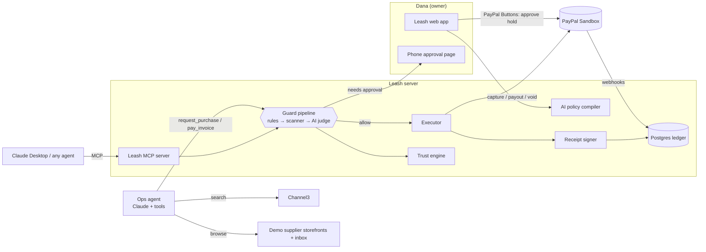
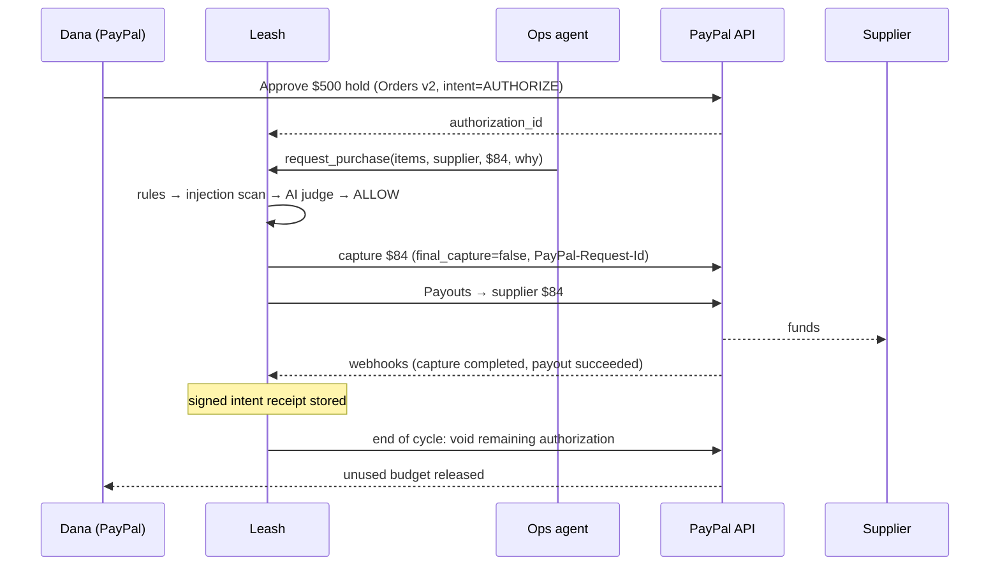

# Leash: Build Plan

> **Leash: spending controls for AI agents, built on PayPal.**
> _PayPal gave AI agents the power to pay. Leash gives people the confidence to let them._

This is a step plan with no calendar dates. Steps run in order. A step is finished when everything under its
**Done when** list is true; then work moves to the next step. Each step's status is tracked in the
checklist below.

The plan has one date in it, the submission deadline: **Nov 12, 2026, 21:00 CET**
(see [Safety rule](#working-protocol)).

---

## Progress

| #   | Step                                                                            | Needs from owner                  | Status |
| --- | ------------------------------------------------------------------------------- | --------------------------------- | ------ |
| 0   | Plan & repo hygiene                                                             | —                                 | ✅     |
| 1   | Foundation (app scaffold, DB, config, CI, design system)                        | —                                 | ✅     |
| 2   | Domain model, seed data, demo supplier storefronts                              | —                                 | ⬜     |
| 3   | Guard core: deterministic policy engine                                         | —                                 | ⬜     |
| 4   | PayPal layer + sandbox-faithful simulator                                       | —                                 | ⬜     |
| 5   | Catalog: Channel3 + demo suppliers + market prices                              | Channel3 key (optional)           | ⬜     |
| 6   | AI layer: compiler, injection scanner, judge, writers                           | Anthropic key (for live)          | ⬜     |
| 7   | Ops agent + execution pipeline                                                  | —                                 | ⬜     |
| 8   | Signed intent receipts + public verifier                                        | —                                 | ⬜     |
| 9   | Product UI: landing, onboarding, control tower, agent console, mobile approvals | —                                 | ⬜     |
| 10  | Ledger on AG Grid (+ natural-language queries)                                  | AG Grid license (optional)        | ⬜     |
| 11  | Autonomy levels & trust engine                                                  | —                                 | ⬜     |
| 12  | Attack Lab                                                                      | —                                 | ⬜     |
| 13  | Go live on PayPal sandbox (**key gate**)                                        | PayPal sandbox app                | ⬜     |
| 14  | Allowance cycle jobs (void, reauthorize, renew, reconcile)                      | —                                 | ⬜     |
| 15  | LeashBench (measured security results)                                          | Anthropic key                     | ⬜     |
| 16  | Bring-your-own-agent: Leash MCP server + Agent Toolkit guard                    | —                                 | ⬜     |
| 17  | Judge mode + deploy to Render                                                   | Render account                    | ⬜     |
| 18  | Hardening & polish                                                              | —                                 | ⬜     |
| 19  | Docs & submission package                                                       | —                                 | ⬜     |
| 20  | Demo video                                                                      | Owner: voiceover + YouTube upload | ⬜     |
| 21  | Submit                                                                          | Owner: Devpost form               | ⬜     |

---

## Working protocol

1. **Step order.** Steps run top to bottom. When a step's _Done when_ items all hold, it gets committed, pushed, ticked
   above, and a short report goes to the owner. Then the next step starts.
2. **Key gates.** A step that needs a key is skipped until the key arrives and gets picked up afterwards. All earlier
   steps are designed to run **without any keys**: the PayPal simulator, catalog fixtures, and heuristic AI
   fallbacks stand in.
   **When PayPal keys arrive, Step 13's verification spike runs right away**, at the next clean stopping point,
   because it tests the riskiest assumption in the whole project (several partial captures on one authorization).
3. **Safety rule (the only date-based rule).** If **T-48h (Nov 10, 21:00 CET)** is reached and Step 17 is not finished,
   all remaining feature steps are dropped and work goes straight to 17 → 18 → 19 → 20 → 21.
   The [cut list](#cut-list-drop-in-this-order) says what to drop first.
4. **Every step leaves the app working.** `npm run dev` works, tests pass, and CI is green after every step.
5. **Honesty in the demo.** Everything shown runs against the PayPal sandbox. The simulator never appears in the
   video or judge mode, except as a clearly labelled fallback banner if the sandbox is down.

---

## 1. Product

### The problem

- In Accenture's 2026 survey of 25,590 consumers, **32%** would let an AI agent make the final purchase decision,
  but only **9%** would let it initiate and complete the payment. Agents can shop, but people don't trust them to pay.
- Business email compromise cost **$3.05B in 2025** (FBI IC3 2025 report). The classic version is a "we changed
  banks, pay this new account" email. AI agents now read supplier emails and act on them.
- Prompt injection is the top security risk for LLM apps (OWASP LLM01). A web page or invoice can carry instructions
  that hijack an agent that holds a payment method.

### Who it's for

**Small-business owners** who want an AI operations agent to handle repetitive purchasing (restocking, supplier
invoices) without risking a rogue or hijacked agent draining the account.

**Demo persona:** _Dana, owner of "Bean There Café" (2 locations)._ Her ops agent restocks coffee beans, oat milk,
cups and cleaning supplies every week and pays supplier invoices from the café inbox.

### The product in one paragraph

Dana tells Leash the rules in plain English. Leash's AI compiles them into a policy that Dana can read and edit. Dana then
approves a **real PayPal authorization hold** for the weekly budget. Her ops agent shops (with Channel3 product data)
and reads supplier invoices, but **it never holds PayPal credentials**. It can only _ask_ Leash to pay. Every request
passes a layered guard:

1. deterministic rules
2. a prompt-injection scanner
3. an AI intent-alignment judge that checks the request traces back to what Dana actually asked for

Allowed purchases are **partial captures** from the hold, and suppliers are paid with **PayPal Payouts**. Out-of-policy
requests go to Dana's phone for one-tap approval. Attacks are blocked, explained, and **shorten the leash**: the agent's
autonomy level drops. Clean track records **lengthen** it, through AI-written promotion proposals. Every payment
carries a **signed intent receipt** that anyone can verify. At the end of the week, the unused budget is **voided**
back to Dana in PayPal.

### Design principles (these go in the pitch)

1. **The agent can ask; only Leash can pay.** The agent has no PayPal access, only Leash tools.
2. **AI can tighten, never loosen.** Deterministic rules are the floor. AI layers can escalate a decision but never
   relax one, so an injection that fools the judge still can't break a rule.
3. **Trust is earned.** Autonomy levels L0–L4 change with the agent's track record.
4. **Every cent is traceable.** Each payment has a signed receipt chain (intent → cart → decision → PayPal IDs).
5. **Money only moves through PayPal.** Holds, captures, payouts, voids.

### Autonomy levels ("leash length")

| Level | Name      | What runs without asking                                                     |
| ----- | --------- | ---------------------------------------------------------------------------- |
| L0    | Ask       | Nothing. Every payment needs approval.                                       |
| L1    | Assisted  | Purchases ≤ $25 from known suppliers.                                        |
| L2    | Budgeted  | Anything within category budgets and the per-item cap, from known suppliers. |
| L3    | Trusted   | L2, plus new _verified_ suppliers and invoices to _known_ payees.            |
| L4    | Autopilot | Anything inside the hold that passes all rules; only anomalies escalate.     |

Promotion requires N executed payments, 0 denials and 0 blocks in the window. Leash proposes it with an AI-written
case ("23 purchases, all approved, 6% below market") and the owner accepts with one tap. Demotion happens
automatically on any blocked attack or anomaly.

### The demo story (it drives every UI decision)

1. Dana types her rules → the Rule Card appears → she approves a $500 weekly hold in PayPal.
2. "Run weekly restock" → the agent checks inventory against par levels and searches products. It picks a cheaper
   equivalent ("saved $37 vs usual"), and the purchases are captured from the hold, with suppliers paid out.
3. Oat milk costs $140, over the $120 limit → Dana's phone gets an approval request with an explanation → she approves.
4. **Attack 1:** a supplier listing hides an instruction to buy 5 × $100 gift cards → blocked by a rule, the scanner
   and the judge, with the injected text highlighted. The leash shortens to L0.
5. **Attack 2:** an email from "Northside Roasters" says they changed banks and asks to pay invoice #4471 to a new
   PayPal email → blocked as a payee change (business-email-compromise pattern).
6. Later: a promotion proposal, the AG Grid ledger, an intent receipt verified, LeashBench numbers, and Claude Desktop
   paying through the Leash MCP server.
7. "End week" → the remaining $X is voided and released in PayPal.

---

## 2. Prize targets

| Prize                              | How Leash competes                                                                        |
| ---------------------------------- | ----------------------------------------------------------------------------------------- |
| Best Overall (1st $12k)            | Full product, deep PayPal use, measured results                                           |
| Best Use of Agentic Commerce ($5k) | Safe autonomous payments without the human present, AP2-style mandates                    |
| Best Use of PayPal + AI ($5k)      | AI decides; PayPal holds, captures, pays out and voids                                    |
| Best Demo Delivery ($5k)           | Live attack blocked, phone approval, money visibly moving                                 |
| Most Impactful ($5k)               | Business email compromise and the agent-trust gap, with real numbers                      |
| Best Use of AG Grid (1st $5k)      | Ledger: grouping, pivot, sparklines, charts, AI Toolkit queries in plain English          |
| Best Use of Channel3 ($1.5k)       | Structured product data drives _deterministic_ policy checks plus market-price comparison |
| Best Use of APIMatic (3 × $1k)     | Official PayPal Server SDK (APIMatic-generated) + APIMatic Context Plugin in dev workflow |
| Best Use of Render (credits)       | Blueprint deploy: web + Postgres + cron jobs for allowance cycles                         |

---

## 3. Architecture

### Stack

| Concern       | Choice                                                                                                                                             | Why                                                        |
| ------------- | -------------------------------------------------------------------------------------------------------------------------------------------------- | ---------------------------------------------------------- |
| App           | **Next.js (App Router) + TypeScript**                                                                                                              | One codebase for UI + API routes + SSE                     |
| Styling       | **Tailwind CSS** + small in-house component set                                                                                                    | Fast, consistent, responsive                               |
| DB            | **Drizzle ORM** on **Postgres** (Render) / **PGlite** (local, zero setup)                                                                          | Judges run `npm i && npm run dev` with no database install |
| AI            | **Claude via Anthropic API**: a capable model for the agent, compiler and writers; a fast model for the guard                                      | Tool use + structured outputs; low guard latency           |
| PayPal        | **@paypal/paypal-server-sdk** (APIMatic-generated) + thin typed REST client for endpoints not in the SDK; **PayPal JS SDK** buttons in the browser | Official tooling; APIMatic prize                           |
| Agent interop | **@modelcontextprotocol/sdk** (Leash MCP server), **@paypal/agent-toolkit** (guarded)                                                              | Bring-your-own-agent                                       |
| Product data  | **Channel3 API** (+ recorded fixtures)                                                                                                             | Real catalog, structured attributes                        |
| Grid          | **AG Grid React (Enterprise features + AI Toolkit)**                                                                                               | Ledger; AG Grid prize                                      |
| Crypto        | Node `crypto` **Ed25519** + RFC 8785 canonical JSON                                                                                                | Signed intent receipts                                     |
| Realtime      | Server-Sent Events                                                                                                                                 | Live agent timeline, approvals                             |
| Tests         | **Vitest** (unit), **Playwright** (e2e)                                                                                                            | Chromium is preinstalled                                   |
| Hosting       | **Render Blueprint** (`render.yaml`): web service, Postgres, cron job                                                                              | One-click deploy                                           |

### System diagram



### Money flow (sandbox accounts)

- **Dana**: sandbox buyer account. Approves the weekly hold.
- **Leash**: sandbox business account (owner of the REST app). Holds the authorization and is the merchant of
  record for captures.
- **Suppliers**: 3 sandbox business accounts (Northside Roasters, Oat & Co, PaperGoods). Receive Payouts.
- **Attacker payee**: an email we control or that doesn't exist. Never paid (blocked).



**Fallback ladder for the hold** (decided by the Step 13 spike):

1. _Primary:_ one AUTHORIZE order per cycle, then several partial captures (`final_capture: false`), then void the rest.
2. _Fallback A:_ vault Dana's PayPal at onboarding (Vault v3). Each purchase is a merchant-initiated order with
   `vault_id`, and the cycle hold is a single authorization captured once at cycle close for the total spent.
3. _Fallback B:_ each purchase is its own authorize + capture against the vaulted token, and the budget is enforced by Leash only.

### PayPal surface

| Capability                                                | Role in Leash                                                       | Step      |
| --------------------------------------------------------- | ------------------------------------------------------------------- | --------- |
| OAuth2 client credentials                                 | Token caching, sandbox/live base URL                                | 4         |
| Orders v2: create (AUTHORIZE), get, authorize             | Weekly budget hold                                                  | 4, 13     |
| Payments v2: capture (partial), void, reauthorize, refund | Draw down per purchase, release remainder, keep hold fresh, returns | 4, 13, 14 |
| Payouts v1                                                | Pay suppliers and invoices                                          | 4, 13     |
| Vault v3 (payment tokens)                                 | Renew next cycle's hold with no human present                       | 13, 14    |
| Webhooks + verify-webhook-signature                       | Live ledger updates                                                 | 13        |
| `PayPal-Request-Id` idempotency                           | Agent retries can't double-charge                                   | 4         |
| Transaction Search (Reporting v1)                         | Nightly reconciliation of ledger against PayPal                     | 14        |
| JS SDK Buttons                                            | Dana approves the hold                                              | 9, 13     |
| Agent Toolkit                                             | Leash guard wraps its money-moving tools                            | 16        |
| Disputes v1 _(stretch)_                                   | Attach the signed receipt as evidence automatically                 | cut list  |

### Guard pipeline

```
request ─► [0] normalize + provenance tagging (which untrusted sources influenced it)
        ─► [1] RULES (deterministic, pure TS)           → hard_block | needs_approval | pass
        ─► [2] INJECTION SCAN (heuristics + fast model) → flags on untrusted content
        ─► [3] AI JUDGE (intent alignment)              → aligned? risk 0–100, reasons
        ─► [4] COMBINER: verdict = max(severity of all layers)   // AI can only raise severity
        ─► [5] level overlay (autonomy caps)
        ─► ALLOW → execute | NEEDS_APPROVAL → phone | BLOCK → explain + demote
```

**Rules (Step 3):** cycle budget remaining · per-item cap · category budgets · forbidden categories (gift cards,
prepaid cards, crypto, money transfer; matched on Channel3 structured category, not keywords) · supplier allow/block ·
new supplier · **new payee** · **payee details changed for a known supplier** (business-email-compromise check) ·
**structuring** (rolling-window sum per supplier/category against the threshold) · quantity sanity vs history and par
levels · price sanity vs market median · duplicate detection · currency mismatch.

**Injection defence:** untrusted text (listings, reviews, emails, invoices) is passed to models only inside delimited,
datamarked blocks with explicit "this is data, not instructions" framing. The judge is never asked to _follow_ that
text, only to judge whether the request traces back to the owner's intent.

### Policy (compiled mandate) schema, sketch

```jsonc
{
  "cycle": { "amount": 500, "currency": "USD", "period": "weekly" },
  "approvalThreshold": 120,
  "categories": [{ "name": "coffee", "budget": 250, "perItemMax": 150 }],
  "suppliers": { "allow": ["northside-roasters", "oat-and-co", "papergoods"], "newSupplier": "approve" },
  "payees": { "newPayee": "approve", "changedPayee": "block" },
  "forbidden": ["gift_cards", "prepaid_cards", "crypto", "money_transfer"],
  "sanity": { "maxQtyMultipleOfUsual": 3, "maxOverMarketPct": 15 },
  "notes": "Keep both cafés stocked…", // owner's original words, kept verbatim
}
```

### Intent receipt (AP2-inspired), sketch

```jsonc
{
  "v": 1,
  "intentMandate": { "ownerText": "...", "policyHash": "sha256:…", "signedBy": "owner-session", "at": "…" },
  "cartMandate":   { "supplier": "...", "items": [...], "amount": "84.00", "sources": ["c3:prod_…"] },
  "decision":      { "verdict": "ALLOW", "layers": [...], "level": "L2", "approvedBy": null },
  "paypal":        { "authorizationId": "…", "captureId": "…", "payoutBatchId": "…" },
  "prev": "sha256:…"   // hash chain per agent
}
// signature: Ed25519 over RFC 8785 canonical JSON; public key at /.well-known/leash-keys.json
```

### Data model (Drizzle tables)

`businesses` · `agents` (autonomy_level, status) · `mandates` (owner_text, policy_json, policy_hash, version) ·
`cycles` (amount, paypal_order_id, authorization_id, captured_total, status, starts/ends) · `suppliers` ·
`payees` (paypal_email, verified_at, first_seen_at) · `inventory_items` (par_level, on_hand, usual_qty) ·
`inbox_messages` (seeded supplier emails/invoices, untrusted) · `payment_requests` (kind, items_json, amount,
justification, provenance_json, status, idempotency_key) · `guard_decisions` (layer, verdict, reasons, latency_ms) ·
`approvals` · `paypal_operations` (op, request_id, paypal_id, status, raw) · `receipts` (payload, hash, prev_hash,
signature) · `agent_runs` · `agent_events` · `trust_events` · `webhook_events` · `bench_runs` · `bench_results`.

### Repo layout

```
src/app/                 routes (marketing, onboarding, app/*, approve/[id], verify/[id], lab, bench, developers, api/*)
src/components/          UI kit + feature components
src/server/db/           drizzle schema, client (pg | pglite), migrations, seed
src/server/guard/        rules/*, scanner, combiner, levels, pipeline
src/server/paypal/       client, orders, payments, payouts, vault, webhooks, reporting, simulator
src/server/ai/           client, policyCompiler, injectionScan, judge, promotionWriter, ledgerQuery
src/server/agent/        tools, opsAgent, runner (events → SSE)
src/server/catalog/      channel3, demoSuppliers, fixtures/, marketPrice
src/server/receipts/     canonical, sign, verify
src/server/trust/        engine
src/server/jobs/         closeCycle, reauthorize, renewCycle, reconcile
mcp/                     Leash MCP server (stdio + streamable HTTP)
bench/                   scenarios/*.json, runner, report
tests/                   unit (vitest), e2e (playwright)
render.yaml              Render Blueprint
docs/                    PLAN.md, ARCHITECTURE.md, SUBMISSION.md, VIDEO_SCRIPT.md
```

---

## 4. Steps

### Step 0: Plan & repo hygiene ✅

**Build:** this plan, MIT `LICENSE`, `.gitignore`, README skeleton.
**Done when:** pushed to `claude/awesome-albattani-sr4pg7`; draft PR open.

### Step 1: Foundation ✅

**Build**

- Scaffold Next.js + TypeScript + Tailwind; ESLint + Prettier; path aliases.
- `src/server/env.ts`: zod-validated env with **feature flags derived from key presence** (`paypal.live`,
  `ai.live`, `channel3.live`, `agGrid.licensed`) so every module can choose live or fallback mode.
- Drizzle + DB client that picks Postgres when `DATABASE_URL` is set, else PGlite (file in `.data/`). Migration
  and seed scripts.
- Design system: color tokens (light/dark), type scale, Button, Card, Badge (verdict colors), Stat, Timeline item,
  Sheet/Dialog, Toast, EmptyState, Skeleton. Brand: calm, trustworthy, a fintech feel; the leash meter is the
  signature visual.
- Vitest config; Playwright config; GitHub Actions CI (typecheck, lint, unit tests, build).
- `.env.example` documenting every variable.

**Done when:** `npm i && npm run dev` serves a styled placeholder with **zero env vars**; `npm test` and `npm run build`
pass; CI green on the PR.

### Step 2: Domain model, seed data, demo supplier storefronts

**Build**

- Full Drizzle schema (tables above) + migrations.
- Seed: Bean There Café (2 locations), inventory with par levels (beans, oat milk, cups, lids, sanitizer…), 3 suppliers +
  verified payees, 20 historical purchases (gives the trust engine a track record), inbox with 4 supplier emails
  (2 legit invoices, **1 business-email-compromise payee-swap email**, 1 promo).
- Public demo storefronts `/suppliers/[slug]` with product pages. One listing carries a **hidden injection**
  (visually hidden text + HTML comment), served exactly as an agent would fetch it.
- Multi-tenant "demo workspace" concept (each judge gets an isolated copy). Implemented in Step 17; the schema
  supports it from here on (`workspace_id` everywhere).

**Done when:** `npm run db:reset` produces the seeded world; storefront pages render; schema tests pass.

### Step 3: Guard core (deterministic policy engine)

**Build**

- Policy zod schema + versioning + `policyHash`.
- Every rule from the list above as a pure function `(request, policy, context) → RuleResult` with a stable code
  (e.g. `PAYEE_CHANGED`, `STRUCTURING_SUSPECTED`) and a human-readable explanation.
- Autonomy level overlays (L0–L4).
- Combiner with the "AI can only raise severity" invariant enforced in code and covered by tests.
- Context builder: rolling windows, supplier/payee history, market price, inventory par levels.

**Done when:** table-driven unit tests for every rule, combiner and level (≥ 90% line coverage on `guard/`); the 4 headline
attacks are rejected by rules alone where they should be (gift cards, payee swap, structuring, duplicate).

### Step 4: PayPal layer + sandbox-faithful simulator

**Build**

- `PayPalGateway` interface: `createAuthorizeOrder`, `getOrder`, `authorizeOrder`, `capture(authId, amount, {final,
requestId, invoiceId, note})`, `void`, `reauthorize`, `refund`, `createPayout`, `getPayout`, `createSetupToken`,
  `createPaymentToken`, `verifyWebhook`, `searchTransactions`.
- Live implementation: PayPal Server SDK where it covers the endpoint, typed `fetch` otherwise; OAuth token cache;
  `PayPal-Request-Id` on every mutation; PayPal error → typed domain error (`INSUFFICIENT_AUTH_AMOUNT`,
  `AUTHORIZATION_EXPIRED`…); a debug-id log for every call.
- Simulator implementation: same interface with an in-DB state machine that mirrors the PayPal rules (115% / +$75 cap,
  honor period, void after final capture fails…), so tests and the bench behave like the real thing.
- Contract test suite that runs against either implementation (`PAYPAL_MODE=sim|sandbox`).

**Done when:** contract suite green on the simulator; sandbox run is ready and only waits for keys (Step 13).

### Step 5: Catalog: Channel3 + demo suppliers + market prices

**Build**

- Channel3 client (search, product details) with response caching; fixture mode with realistic recorded-shape data for
  every seeded inventory item.
- Merge Channel3 results with demo supplier offers into one `Offer` model (supplier, price, category, attributes,
  `untrustedText`, source ref).
- `marketPrice(itemType)`: median / p25 across Channel3 offers, used by price-sanity checks and the savings figure.
- Category normalization to Leash categories (feeds the forbidden-category rule deterministically).

**Done when:** offline search returns merged offers for every inventory item; market price computed; switching to live
works as soon as `CHANNEL3_API_KEY` is set.

### Step 6: AI layer

**Build** (load the Claude API reference before writing this code)

- `ai/client.ts`: Anthropic SDK wrapper: model selection via env, timeouts, retries, token/cost accounting, prompt
  caching for long system prompts, structured outputs (JSON schema / tool-forced).
- **Policy compiler:** owner's words → policy JSON + plain-English Rule Card + clarifying questions when ambiguous;
  also supports **edit by instruction** ("allow PaperGoods for napkins too") with a diff.
- **Injection scanner:** heuristic layer (always on) + fast-model classifier over datamarked untrusted text; returns
  highlighted spans.
- **Intent-alignment judge:** input = owner text + policy + request + provenance (quoted untrusted excerpts); output
  = `{aligned, risk, reasons[], suspiciousSourceIds[]}`.
- **Writers:** promotion case, block explanation for the owner, weekly summary.
- **Ledger query:** natural language → AG Grid state (filters/grouping/sort) via the grid's structured schema (used in
  Step 10).
- Offline fallbacks: heuristic scanner, rules-only judge (labelled), canned compiler output for the seeded rules text.

**Done when:** each AI function has fixture tests (offline) and a `live` test that runs when the key exists; the seeded
rules text compiles to the expected policy; both headline attacks get high-risk verdicts from the judge.

### Step 7: Ops agent + execution pipeline

**Build**

- Agent tools: `check_inventory`, `search_products`, `get_product` (returns untrusted text), `read_inbox`,
  `get_budget`, `request_purchase`, `pay_invoice`, `finish`. **No PayPal tools.**
- Agent loop (Claude tool use) with a step budget; every thought/tool call/guard result is emitted as an `agent_event`
  and streamed over SSE.
- Execution: ALLOW → capture (idempotent) → payout → receipt → ledger; NEEDS_APPROVAL → approval record + notify;
  BLOCK → explanation + trust demotion + notify. Approval decisions resume execution.
- Scripted "weekly restock" task + free-form tasks.

**Done when:** in simulator mode, `npm run demo:restock` produces the expected story deterministically (with fixture AI):
N allowed, 1 needs approval, 2 attacks blocked, correct ledger rows, retry produces no double capture.

### Step 8: Signed intent receipts + public verifier

**Build**

- RFC 8785 canonicalization, SHA-256 hash chain per agent, Ed25519 signing (key from env; auto-generated for dev).
- Receipt ID attached to the PayPal capture (`invoice_id` / `note_to_payer`) so it is visible in PayPal.
- `/verify/[id]`: public page showing the chain (owner intent → cart → guard decision → PayPal IDs), signature ✓,
  tamper detection, QR code; `/.well-known/leash-keys.json`.

**Done when:** verifying a stored receipt passes; changing one byte fails; page renders on mobile.

### Step 9: Product UI (the design pass)

**Build**

- **Landing** `/`: hero with the pitch, problem stats, 3-step how-it-works, "Try the live demo" CTA, architecture.
- **Onboarding**: (1) meet the café (prefilled), (2) "Tell your agent the rules" → AI → **Rule Card**
  (auto / ask-me / never columns, editable), (3) **Fund the leash** with PayPal Buttons (authorize).
- **Control tower** `/app`: **leash meter** (held / spent / remaining + level), live activity, pending approvals,
  savings this week, blocked attacks.
- **Agent console** `/app/agent`: run restock or a custom task; live timeline with colour-coded guard verdicts and a
  drill-down into each layer's reasoning.
- **Mobile approval** `/approve/[id]`: what, why, which rule triggered, AI risk summary; Approve / Deny / Approve &
  update rule. A QR code on desktop opens it on the phone; Web Push where supported.
- **Rules** `/app/rules`: mandate versions, plain-English edits with diff.
- Every view handles loading, empty and error states; responsive down to 375px; keyboard and contrast checked.

**Done when:** the whole demo story (minus the ledger, trust and lab pages) is clickable end to end in simulator mode on
desktop and phone widths.

### Step 10: Ledger on AG Grid

**Build**

- `/app/ledger` on AG Grid: holds, captures, payouts, voids, blocks, approvals in one stream; row grouping (supplier /
  category / agent / cycle), pivot mode, sparklines per supplier, integrated charts, status renderers, export.
- **Ask the ledger** box: natural language → AG Grid state through the grid's AI Toolkit / structured state API (Step 6
  writer), e.g. _"blocked or declined over $50 this week, grouped by supplier"_.
- Row detail drawer linking to the receipt verifier and the PayPal IDs.

**Done when:** 3 scripted NL queries produce the right grid state; works with the trial watermark; license key picked up
from env if provided.

### Step 11: Autonomy levels & trust engine

**Build**

- Trust engine: rolling stats, eligibility per level, automatic demotion on blocks or anomalies.
- `/app/trust`: level ladder, track-record stats, **AI promotion proposal card** (accept / decline), history.
- Level changes flow into guard overlays immediately.

**Done when:** the seeded history plus a clean run produces an L1 → L2 proposal; an attack demotes to L0; tests cover the
eligibility math.

### Step 12: Attack Lab

**Build**

- `/lab`: 4 preset attacks (hidden injection → gift cards, business-email payee swap, structuring, duplicate retry) +
  1 legit control.
- Custom attack editor (write a malicious listing or email), run the agent against it in an isolated workspace, watch the
  guard live.
- Public "attacks blocked" counter; rate limiting + cost cap + kill switch.

**Done when:** all presets are blocked with clear explanations, the control passes, and custom attacks run sandboxed.

### Step 13: Go live on PayPal sandbox (key gate)

**Needs:** PayPal Developer sandbox app credentials (client ID + secret) added as environment secrets.
**Build**

- Create and configure sandbox accounts (Leash business, Dana buyer, 3 suppliers); enable Vault + Payouts on the app.
- **Spike script** `scripts/spike-paypal.ts`: authorize → partial capture ×3 (`final_capture:false`) → void remainder;
  reauthorize; payouts; vault setup token → payment token → merchant-initiated authorize. Buyer approval automated
  with Playwright against the sandbox checkout.
- Pick the hold strategy from the fallback ladder based on what the spike shows; record the result in
  `docs/ARCHITECTURE.md`.
- Webhook endpoint + signature verification + event processing into the ledger.
- Run the Step 4 contract suite against the sandbox.

**Done when:** the full demo story runs on real sandbox money, and the IDs are visible in the sandbox accounts.

### Step 14: Allowance cycle jobs

**Build**

- `closeCycle` (void the remainder, summary), `reauthorize` (after the honor period, when used), `renewCycle` (next
  hold via vaulted token, with no human present), `reconcile` (Transaction Search compared with the ledger, mismatches flagged).
- Render cron entry; **"End week now"** button in judge mode runs the same code.

**Done when:** a cycle can be closed and renewed on the sandbox; reconciliation reports 0 mismatches after a demo run.

### Step 15: LeashBench

**Build**

- ~60 scenarios as JSON (≈30 attacks across: hidden injection, gift/prepaid cards, payee swap, urgency social
  engineering, structuring, quantity inflation, price gouging, currency trick, duplicate retry, category drift; ≈30
  legit including tricky ones: legit new supplier, legit price rise, legit large monthly order).
- Runner (simulator PayPal, live AI) with three configurations: **rules only**, **AI only**, **layered**.
- Report: attack block rate, false-positive rate, p50/p95 latency, cost per check; JSON + Markdown + `/bench` page.

**Done when:** the numbers are published in the README and on `/bench`; the layered config beats both single-layer configs.

### Step 16: Bring-your-own-agent

**Build**

- Leash MCP server (`mcp/`): stdio (Claude Desktop) + streamable HTTP (hosted) with per-agent API keys; tools
  `get_budget`, `search_products`, `request_purchase`, `pay_invoice`, `get_request_status`.
- **Agent Toolkit guard:** wrap the money-moving tools of `@paypal/agent-toolkit` so they route through the Leash
  pipeline; example script.
- `/developers` page with copy-paste Claude Desktop config.

**Done when:** an external MCP client completes a purchase that appears in the ledger with a receipt; an injected
request from it gets blocked.

### Step 17: Judge mode + deploy to Render

**Needs:** Render account (owner connects the GitHub repo).
**Build**

- `/demo`: one click creates an isolated, seeded workspace; panel showing the sandbox buyer login for the PayPal approval;
  "End week now", "Reset demo".
- `render.yaml` Blueprint: web service, Postgres, cron job; health check; env groups; README "Deploy to Render" button.
- Production hardening: rate limits, secure headers, error pages, sandbox-outage banner.

**Done when:** the hosted URL works from a fresh browser; a new judge completes the core story in under 2 minutes.

### Step 18: Hardening & polish

**Build:** Playwright e2e for the demo story + Attack Lab; copy pass; accessibility pass; performance (guard p95
< 2.5s); realistic seed data; final visual polish; dependency audit.
**Done when:** e2e suite green against the hosted URL; no console errors; Lighthouse ≥ 90 for accessibility on key pages.

### Step 19: Docs & submission package

**Build**

- **README:** problem → solution → live demo link → screenshots/GIF → features → how PayPal is used (table) → how AI
  is used (table) → sponsor tools → architecture diagram → LeashBench results → run locally (zero-key mode + live
  mode) → tests → license.
- `docs/ARCHITECTURE.md`, `docs/SUBMISSION.md` (Devpost text: inspiration, what it does, how we built it, challenges,
  accomplishments, what's next, **tools used and how**).
- Repo About section: description, website, topics, MIT license visible.

**Done when:** someone new can understand, run and evaluate the project from the README alone.

### Step 20: Demo video

Details are agreed with the owner when we reach this step. Prepared by me: script + shot list (≤ 2:50), Playwright-scripted
screen captures of every scene, captions. Owner: voiceover and YouTube upload (public).

### Step 21: Submit

Final checklist: repo public · MIT license in About · hosted URL live · README complete · video public on YouTube · Devpost
form (description, tools, links) · release tag `v1.0.0`. **Submit before Nov 12, 21:00 CET**, ideally a day early.

---

## Cut list (drop in this order)

1. Disputes API auto-evidence
2. Bryntum cycle calendar (only if its use would be genuine)
3. Login with PayPal
4. Web Push (keep the QR + live approval page)
5. Reauthorize job
6. Custom attacks in the Attack Lab (keep presets)
7. Hosted MCP over HTTP (keep stdio + Claude Desktop)
8. Vault-based renewal (keep "End week" void + manual new hold)
9. AG Grid natural-language queries (keep the rich grid)

**Never cut:** the PayPal hold → capture → payout → void flow, the guard with both headline attacks, mobile approval,
autonomy levels, signed receipts, the AG Grid ledger, judge mode on Render, the README.

## Risks & mitigations

| Risk                                                          | Mitigation                                                            |
| ------------------------------------------------------------- | --------------------------------------------------------------------- |
| Several partial captures not supported on the sandbox account | Spike as soon as keys arrive; fallback ladder A/B is already designed |
| Payouts not enabled on the sandbox app                        | Enable in app settings; contract tests catch it early                 |
| Sandbox slow or down during judging                           | Retries + status banner + labelled simulator fallback                 |
| LLM latency on stage                                          | Fast model for the guard, layers in parallel, streaming UI            |
| Public Attack Lab abuse / cost                                | Rate limits, token caps, isolated workspaces, kill switch             |
| Injection fools the AI judge                                  | Deterministic floor: AI can only escalate (tested invariant)          |
| Scope creep                                                   | Cut list + T-48h safety rule                                          |

## Inputs needed from the owner (and when)

| Input                                 | Needed at                  | Without it          |
| ------------------------------------- | -------------------------- | ------------------- |
| PayPal sandbox app (client ID/secret) | Step 13 (sooner is better) | Simulator only      |
| Anthropic API key                     | Step 6 live tests, Step 15 | Heuristic fallbacks |
| Channel3 API key                      | Step 5 (optional)          | Fixtures            |
| AG Grid license key                   | Step 10 (optional)         | Trial watermark     |
| Render account                        | Step 17                    | Local only          |
| Voiceover + YouTube upload            | Step 20                    | —                   |
| Devpost submission                    | Step 21                    | —                   |

Secrets go into the environment settings, never into the repo or the chat.
